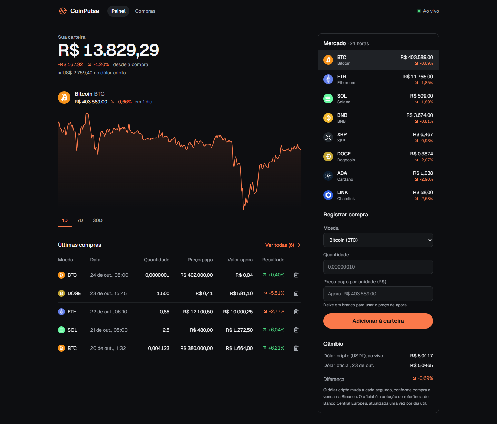

# CoinPulse

Carteira de criptomoedas com preços em tempo real, construída do zero ao longo de uma semana de seminário de React no curso de Ciência da Computação da PUC Minas Poços de Caldas.



## O que o app faz

- Mostra o preço de 8 criptomoedas **ao vivo**, direto da Binance, sem recarregar a página.
- Registra compras com até **8 casas decimais** (0,00000001 BTC) e calcula o lucro ou prejuízo sem erros de arredondamento.
- Desenha o gráfico de preço de cada moeda (1 dia, 7 dias ou 30 dias), atualizando sozinho.
- Compara o **dólar cripto** (USDT/BRL, ao vivo) com o **dólar oficial** (cotação diária).
- Lista todas as compras com filtro por moeda e ordenação por data, moeda ou valor investido.
- Muda a cor do app conforme o resultado da carteira: verde no lucro, vermelho no prejuízo.

## Como rodar

Você precisa do [Node.js](https://nodejs.org) 20 ou mais novo.

```bash
git clone https://github.com/viniciusmachioni/seminarios-coin-pulse.git
cd seminarios-coin-pulse/dia-5
npm install
npm run dev
```

Abra o endereço que aparecer no terminal (normalmente http://localhost:5173).

## Estrutura do repositório

Cada pasta `dia-N` é um projeto completo, do jeito que ele fica **no fim daquele dia**. Ficou para trás numa aula? Abra a pasta do dia anterior e continue de lá.

| Pasta | O que tem |
|---|---|
| [`slides/`](slides) | Slides da primeira aula. Abra o `index.html` no navegador (← → para navegar, F para tela cheia). |
| [`kit-inicial/`](kit-inicial) | Arquivos entregues prontos no Dia 1: tema, lista de moedas, preços de exemplo e funções de formatação. |
| [`dia-1/`](dia-1) | **Componentes e props.** O painel montado com preços fixos. |
| [`dia-2/`](dia-2) | **Estado e números.** Formulário de compra, tabela e contas exatas com big.js. |
| [`dia-3/`](dia-3) | **Efeitos e tempo real.** Compras salvas no navegador e preços ao vivo pelo WebSocket. |
| [`dia-4/`](dia-4) | **Gráfico.** Gráfico ao vivo, preço que pisca ao mudar e o câmbio do dólar. |
| [`dia-5/`](dia-5) | **Rotas e deploy.** Página de compras com filtros, página 404 e configuração para a Vercel. É o app completo. |

## Conceitos de cada dia

| Dia | React | JavaScript e web |
|---|---|---|
| 1 | JSX, componentes, props, `map` e `key` | `import` / `export`, Tailwind CSS |
| 2 | `useState`, formulário controlado, levantar estado | por que `0.1 + 0.2 !== 0.3`, big.js, `Intl.NumberFormat` |
| 3 | `useEffect`, cleanup, hooks customizados, estado derivado | `localStorage`, WebSocket, `fetch` |
| 4 | `useRef`, `key` para recriar um componente | Recharts, Web Animations API |
| 5 | react-router: `Routes`, `Outlet`, `NavLink`, `useSearchParams` | deploy na Vercel |

## Tecnologias

- [React](https://react.dev) + [Vite](https://vite.dev)
- [Tailwind CSS](https://tailwindcss.com)
- [React Router](https://reactrouter.com)
- [Recharts](https://recharts.org) para o gráfico
- [big.js](https://github.com/MikeMcl/big.js) para contas com dinheiro
- [Lucide](https://lucide.dev) para os ícones

## APIs usadas (gratuitas, sem cadastro)

- [Binance](https://developers.binance.com/docs/binance-spot-api-docs): preços ao vivo (WebSocket) e histórico do gráfico (REST)
- [Frankfurter](https://frankfurter.dev): cotação oficial do dólar, do Banco Central Europeu

## Desafios

Para praticar depois da semana, do mais fácil ao mais difícil:

1. Mostrar o total da carteira no título da aba do navegador.
2. Adicionar uma nova moeda (a Binance tem o par `LTCBRL`).
3. Ordenar a tabela de compras clicando no cabeçalho da coluna.
4. Permitir editar uma compra já registrada.
5. Criar um alerta que avisa quando uma moeda passar de um preço.
